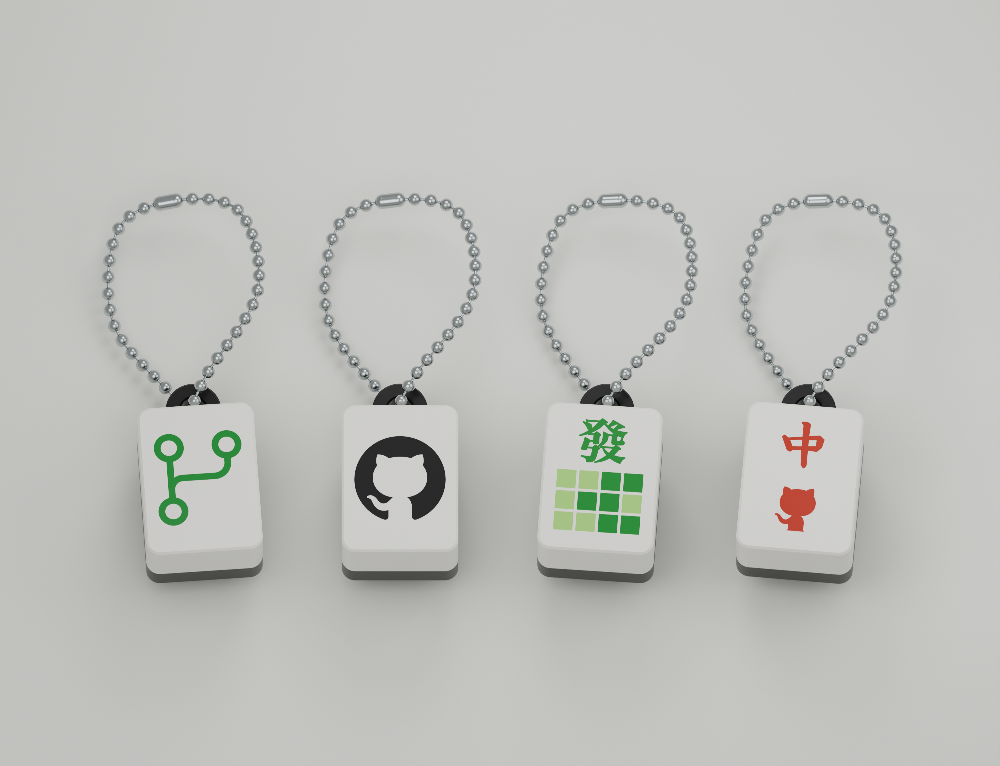

# Mahjong keychains

**[日本語](README.md) | English**

Three designs: Git branch, the GitHub Invertocat, and Hatsu (發) above a 4-column × 3-row contribution grid. Includes **configured Bambu Lab P1S · 0.2 mm nozzle · AMS · PLA project 3MFs**. Each part already has its filament assignment; no repainting is needed.

[Open the 360° viewer in English](https://ktanino10.github.io/github-mahjong-keychains/#en) · [日本語で表示](https://ktanino10.github.io/github-mahjong-keychains/#ja) · [Download standalone offline HTML](https://github.com/ktanino10/github-mahjong-keychains/raw/refs/heads/main/docs/index.html)



## Downloads

| Project | Printable parts | Colors used |
| --- | ---: | --- |
| [All three designs](https://github.com/ktanino10/github-mahjong-keychains/raw/refs/heads/main/print-package/projects/all-three-P1S-0.2-AMS-PLA.3mf) | 10 | White, black, green, light green |
| [Git branch](https://github.com/ktanino10/github-mahjong-keychains/raw/refs/heads/main/print-package/projects/git-branch-P1S-0.2-AMS-PLA.3mf) | 3 | White, black, green |
| [Invertocat](https://github.com/ktanino10/github-mahjong-keychains/raw/refs/heads/main/print-package/projects/invertocat-P1S-0.2-AMS-PLA.3mf) | 3 | White, black |
| [Hatsu](https://github.com/ktanino10/github-mahjong-keychains/raw/refs/heads/main/print-package/projects/hatsu-P1S-0.2-AMS-PLA.3mf) | 4 | White, black, green, light green |

[Print bundle ZIP: four projects, ten STLs, bilingual instructions and offline HTML](https://github.com/ktanino10/github-mahjong-keychains/raw/refs/heads/main/docs/downloads/github-mahjong-keychains-P1S-0.2-AMS-PLA.zip)

These are **not** generic geometry-only 3MFs with display colors. They retain printer, process, PLA settings, per-part filament numbers, placement and flushing volumes. Metal hardware is excluded from every STL and 3MF. Ready-to-send machine-specific G-code is not distributed.

## Printing

1. Open a 3MF **as a project** in **Bambu Studio 02.09.01.70**, not as geometry only. Do not independently arrange its component parts.
2. Confirm **Bambu Lab P1S 0.2 nozzle** and the four numbered PLA colors below. Every project retains the same palette; unused colors are not consumed.
3. Match the project's filament numbers to the **actual PLA spools in your AMS** in the print dialog. Part assignments are saved; physical tray mapping remains a hardware-specific step. Confirm that the installed nozzle really is 0.2 mm.
4. The saved bed is **Textured PEI Plate**, with stock Generic PLA temperatures of 220 °C nozzle and 55 °C bed. If your actual plate or filament needs different temperatures, select the appropriate settings and re-slice.
5. Start with a single-design project. Inspect the ear, inlays, filament assignments and prime tower in Preview, then inspect the first physical print for hole clearance, layer bonding, damage and color contamination before fitting hardware.

The repository's build and verification scripts do not connect to a printer, transmit jobs or start printing.

### Filament map

| Project slot | Color | Display RGB | Assignment |
| ---: | --- | --- | --- |
| 1 | White | `#F6F5EE` | White body of every design |
| 2 | Black | `#161616` | Rear, entire ear and Invertocat inlay |
| 3 | Green | `#238636` | Git branch, Hatsu and dark grid cells |
| 4 | Light green | `#9DD96C` | Light Hatsu grid cells |

RGB values are visual references, not a guarantee of any manufacturer's PLA shade. See the [per-part color table](print-package/parts-and-colors.csv).

### Saved process

0.10 mm normal and first layers; six walls; eight top and bottom layers; 100% Rectilinear infill; no supports; black rear down; prime tower enabled. Outer walls run at 40 mm/s, inner walls at 60 mm/s and top surfaces at 30 mm/s, retaining the stock 0.2 mm Generic PLA volumetric limit of 1.6 mm³/s. Flushing into the object or its infill is disabled to reduce color contamination.

The machine is the official **P1S 0.2 mm** preset. Its process inherits `0.10mm Standard @BBL X1C 0.2 nozzle`: this is the **shared process explicitly designated as the default by the official P1S 0.2 mm profile**, not a switch to an X1 printer. All four materials inherit `Generic PLA @0.2 nozzle`. [Settings and provenance](validation/profile-provenance.json)

Flushing volumes are conservative starting values, with more flushing from dark to light. Actual pigment transitions still need a physical test. The combined project is estimated at approximately **11 h 12 min and 54 g**, including flushing and the tower; these are slicer estimates, not measured print results.

## Dimensions and hardware

| Feature | Dimension |
| --- | --- |
| Tile body, height × width × thickness | **28 × 21 × 16.5 mm** |
| Height including ear | 36 mm |
| Ear thickness / hole diameter | 5 mm / Ø4.6 mm |
| Black rear / white side of body | 5.5 mm / 11 mm |
| Shared black/white boundary | z = 5.5 mm |
| Surface inlays | z = 15.7–16.5 mm |

All ten printable STLs are byte-identical to the accepted source geometry. The ear outline, body size, front/back proportions, logos, glyph and grid are unchanged. No transverse body hole was added. The AMOS SMART reference matches only its [listed external dimensions](https://www.alban.co.jp/products/detail/682), not its material, weight or strength.

**Default: purchased-style ball chain.** The [product listing](https://www.amazon.co.jp/dp/B0DN6JW6LK) specifies 2.4 mm balls and 120 mm chain length. The viewer shows a loop through the existing ear. Pitch, bead count, connector dimensions and drape are approximate. Silver is an illustrative finish, not an inference about the purchased color. Detach the connector, pass the free beaded end through the hole and reconnect; do not force the connector itself through the ear.

**Alternate: wire-gate swivel clasp.** The [referenced product](https://www.amazon.co.jp/dp/B0FX47WYC4) has a rounded clasp, thin wire gate, short axial swivel and lower jump ring. Its title lists 42 mm, while the bullets give 44 × 18 mm. Internal proportions are approximate. The lower-ring bore and wire thickness are unknown, so **this option is a fit-unverified visual reference only**. Ball-chain mounting remains the supported design intent. No marketing images or order information are redistributed.

**Physical printing, actual hardware fit and strength are untested.** PLA can soften in heat. Avoid strong pulls and stop using a part if it chips or delaminates. Do not use this model for load-bearing or safety-critical purposes.

## Using the HTML

The **日本語 / English** buttons switch the full interface, including settings, notices, dynamic status, errors and accessible labels. Download `index.html` and open it in a browser: the models, Three.js, fonts and poster are embedded, so viewing needs **no external requests**. “Save HTML” preserves the chosen language in another standalone copy. The 3MF download links require an internet connection.

Drag, use one finger or arrow keys to rotate. Scroll, pinch or press `+` / `-` to zoom; `Home` fits the view. Choose designs, front/back/side/angle views, hardware visibility and type, and auto rotation. Auto rotation is off initially.

## Verification and rebuilding

All four finished project files were **reopened and sliced in the real Bambu Studio CLI without passing external presets or setting overrides**. Each has 165 layers and an empty plate-warning field. Verification checks part assignments and actual toolpath colors: black at layers 1–55, white at 56–157, and the relevant inlay colors at 158–165. Vertex correspondence, every triangle's connectivity and winding, dimensions and alignment are compared with the original STLs.

[Slicer results](validation/slicer-checks.json) · [Accepted STL SHA-256 hashes](validation/accepted-meshes.json) · [Browser results](validation/browser-checks.json) · [Download SHA-256 hashes](https://github.com/ktanino10/github-mahjong-keychains/blob/main/validation/deliverables.json)

The desktop CLI emits some misleading diagnostics about optional expanded-profile lookups and an already-present flushing matrix. These are classified, not hidden, in the verification JSON. Saved colors, actual used filaments, every layer and the empty plate-warning field are independently checked. This does not claim that every diagnostic log line is warning-free.

Development uses Python 3.13, Node.js, Blender and the Bambu Studio release above. **Rebuilding is unnecessary for printing.**

```sh
python3 -m pip install -r requirements.txt
python3 scripts/prepare_assets.py
python3 scripts/package_models.py --bambu "$BAMBU" --profiles "$BBL_PROFILES"
python3 scripts/validate_projects.py --bambu "$BAMBU"
"$BLENDER" --background --factory-startup --python scripts/render_scene.py
"$BLENDER" --background --factory-startup --python viewer/export_viewer.py
python3 viewer/check_geometry.py
python3 scripts/make_deliverables.py --poster-only
cd viewer
npm ci
npm run build
npm test
cd ..
python3 scripts/make_deliverables.py
python3 scripts/audit_public.py
```

`BAMBU` and `BLENDER` are executable paths. `BBL_PROFILES` is the **application-supplied** `Resources/profiles/BBL` directory, never a personal printer-profile directory. Intermediate files stay under `.work/`. Only when deliberately redesigning STLs, set `OPENSCAD` and use `scripts/build_variant.py git_branch`, etc. Normal project generation and packaging never modify the accepted STLs.

Not an official GitHub product. **The code's MIT license does not freely license the logos, glyph or derived model geometry as a whole.** See [asset-specific rights and licenses](ASSET-LICENSES.md).
