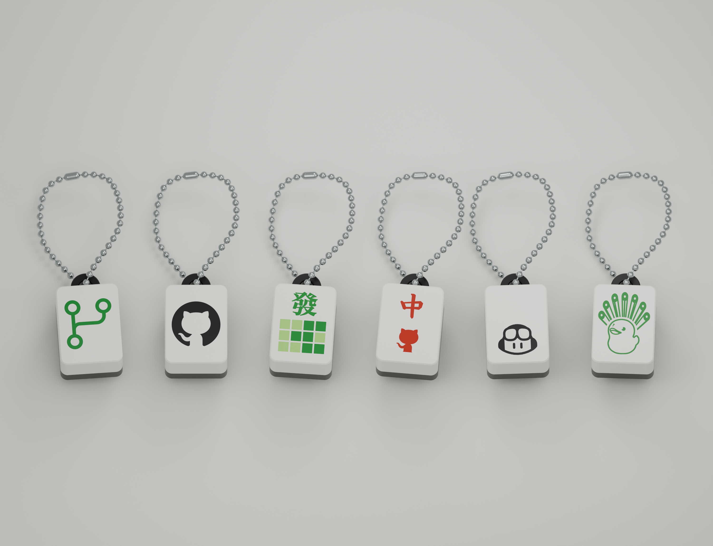
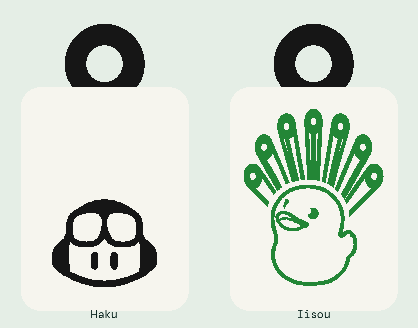

# 麻雀牌キーホルダー

**日本語 | [English](README.en.md)**

Git branch、GitHub Invertocat、發＋4列×3行のコントリビューショングリッド、**赤い中＋円なしの赤い猫**に、**文字なしの白**と**緑の孔雀風Duckyの一索**を加えた6種類です。Git branchは最初の1種類をそのまま保持しています。既存13 STL・5プロジェクトは変更していません。**Bambu Lab P1S・0.2 mmノズル・AMS・PLA用の設定済みプロジェクト3MF**を収録し、パーツの塗り直しは不要です。GitHub公式・公認商品ではありません。

[日本語で360°ビューを開く](https://ktanino10.github.io/github-mahjong-keychains/#ja) · [Open viewer in English](https://ktanino10.github.io/github-mahjong-keychains/#en) · [オフラインHTMLをダウンロード](https://github.com/ktanino10/github-mahjong-keychains/raw/refs/heads/main/docs/index.html)



## ダウンロード

| プロジェクト | 印刷パーツ数 | 使用する色 |
| --- | ---: | --- |
| [既存3種類セット（変更なし）](https://github.com/ktanino10/github-mahjong-keychains/raw/refs/heads/main/print-package/projects/all-three-P1S-0.2-AMS-PLA.3mf) | 10 | 白・黒・緑・薄緑 |
| [中（独立したプロジェクト）](https://github.com/ktanino10/github-mahjong-keychains/raw/refs/heads/main/print-package/projects/chun-P1S-0.2-AMS-PLA.3mf) | 3 | 白・黒・赤 |
| [白：文字なし・下寄せアイコン](https://github.com/ktanino10/github-mahjong-keychains/raw/refs/heads/main/print-package/projects/haku-P1S-0.2-AMS-PLA.3mf) | 3 | 白・黒 |
| [一索：左右反転した斜めDucky＋孔雀風尾羽](https://github.com/ktanino10/github-mahjong-keychains/raw/refs/heads/main/print-package/projects/iisou-P1S-0.2-AMS-PLA.3mf) | 3 | 白・黒・緑 |
| [Git branch](https://github.com/ktanino10/github-mahjong-keychains/raw/refs/heads/main/print-package/projects/git-branch-P1S-0.2-AMS-PLA.3mf) | 3 | 白・黒・緑 |
| [Invertocat](https://github.com/ktanino10/github-mahjong-keychains/raw/refs/heads/main/print-package/projects/invertocat-P1S-0.2-AMS-PLA.3mf) | 3 | 白・黒 |
| [發](https://github.com/ktanino10/github-mahjong-keychains/raw/refs/heads/main/print-package/projects/hatsu-P1S-0.2-AMS-PLA.3mf) | 4 | 白・黒・緑・薄緑 |

[印刷用一式ZIP（7プロジェクト・19 STL・日英説明・オフラインHTML）](https://github.com/ktanino10/github-mahjong-keychains/raw/refs/heads/main/docs/downloads/github-mahjong-keychains-P1S-0.2-AMS-PLA.zip)

**既存3種セット、中、白、一索は別の印刷プロジェクトです。** 全6種では白・黒・緑・薄緑・赤の計5色になるため、1台の4スロットAMSで同時には扱えません。全6種をまとめた5色プロジェクトは配布していません。中の印刷時は必要に応じて赤スプールへ差し替え、各プロジェクトを実際のAMSスプールへ対応付けてください。既存5ファイルの色割当とURLは維持しています。

これらは表示色だけを付けた汎用3MFではありません。プリンター、工程、PLA設定、パーツのフィラメント番号、配置、パージ量を保存したBambu Studioプロジェクトです。金属チェーンやフックはSTL・3MFに含みません。印刷機へそのまま送るG-codeは配布していません。

### 新しい2種類

**白 / Haku：牌面に文字はありません。** 提供された135×110画像の黒い輪郭をトレースし、ゴーグル2つの白抜き、下の白い顔、口元の黒い2本を保持しています。幅13.2 mm、下余白約2.87 mmで、黒い図形の上端も牌の中心より下です。上半分は空白で、背景の四角いパッチはありません。「白」「Haku」「Copilot」や数字はモデルに入れていません。従来のCopilot風素材であり、現行の承認済みロゴとは主張しません。

**一索 / Iisou：斜め正面のDuckyを左右反転し、緑の孔雀風にしています。** [公式Brand Toolkit](https://brand.github.com/graphic-elements/mascots)の中央にあるDuckyを基に、くちばしが左を向くよう反転。丸い頭・体、両目、くちばしを残し、その背後に左右対称の7枚の尾羽を加えています。小さい方の目だけは輪郭・くちばしと接しないよう最小限内側・上方へ移動しています。印刷可能な平らな線画で、グラデーション、黄色、オレンジや数字は使いません。公式の新しいマスコットや配色ではなく、加工したカスタム絵柄です。



## 印刷手順

1. **Bambu Studio 02.09.01.70**で3MFを「プロジェクト」として開きます。形状のみの読み込みや、パーツの個別自動配置はしないでください。
2. プリンターが **Bambu Lab P1S 0.2 nozzle**、PLAが下記の番号になっていることを確認します。既存3種用の4ファイルは従来の4色パレット、中は白・黒・赤、白は白・黒、一索は白・黒・緑です。
3. 実際のAMSに入れたPLAスプールを、印刷ダイアログで対応させます。**プロジェクトの色番号は設定済みですが、物理的なAMSスロットとの対応は機器側の確認が必要です。** 実ノズルが0.2 mmであることも確認してください。
4. 設定済みのプレートは **Textured PEI Plate**、PLA温度はノズル220 °C・ベッド55 °Cです。実際に使用するプレートとスプールの指定温度が異なる場合は、実物に合わせてから再スライスしてください。
5. まず単品プロジェクトで試作し、プレビューの耳・インレイ・各色割当・パージタワーを確認します。印刷後は穴、積層の接合、欠け、色移りを確認してから金具を取り付けてください。

本リポジトリの生成・検証処理はプリンターに接続せず、送信や印刷開始を行いません。

### 色番号

**既存3種用の4プロジェクト：従来の共通パレット**

| プロジェクト番号 | 色 | 表示用RGB | 割当 |
| ---: | --- | --- | --- |
| 1 | 白 | `#F6F5EE` | 各牌の白い本体 |
| 2 | 黒 | `#161616` | 背面・耳全体・Invertocatインレイ |
| 3 | 緑 | `#238636` | Git branch・發・濃緑のグリッド |
| 4 | 薄緑 | `#9DD96C` | 發の薄緑のグリッド |

**中の専用プロジェクト：独立した3色パレット**

| プロジェクト番号 | 色 | 表示用RGB | 割当 |
| ---: | --- | --- | --- |
| 1 | 白 | `#F6F5EE` | 白い本体 |
| 2 | 黒 | `#161616` | 共通の背面・耳全体 |
| 3 | 赤 | `#B33220` | 上の中と、円なしの猫（頭・胴体・しっぽ） |

中は白い本体・共通の黒背面・赤いインレイの**3パーツ・3色**です。赤いSTLには離れた中と猫の2つの閉じた立体が入り、白い本体のくぼみと座標が一致します。別々に自動配置しないでください。旧黒円の表面パーツは削除し、グラデーション印刷も使いません。

**白・一索の専用プロジェクト**

| プロジェクト番号 | 色 / RGB | 白（2色） | 一索（3色） |
| ---: | --- | --- | --- |
| 1 | 白 `#F6F5EE` | 白い本体 | 白い本体 |
| 2 | 黒 `#161616` | 共通の背面・耳、下のアイコン | 共通の背面・耳 |
| 3 | 緑 `#238636` | 使用しません | Duckyと孔雀風の尾羽 |

どちらも本体・背面・インレイの3 STLです。1つのインレイSTLに複数の離れた立体が含まれるため、分解や個別の自動配置はしないでください。白は2色だけ、一索は3色だけを保存し、不要な4色目は設定していません。

**円を取り除いて猫だけ赤にしても、加工・文字との組み合わせ・キーホルダー製作・公開や配布が自動的に許可されるわけではありません。** [公式ガイドライン](https://brand.github.com/foundations/logo)に従い、今回の加工と用途に対応したGitHubの書面許可を別途確認してください。

RGBは画面表示の目安で、特定メーカーのPLA色を保証するものではありません。[パーツ別対応表](print-package/parts-and-colors.csv)も収録しています。

### 保存済みの造形設定

積層・初層とも0.10 mm、外周6周、上下8層、充填100%（Rectilinear）、サポートなし、背面を下にした配置、パージタワーあり。外壁40 mm/s、内壁60 mm/s、上面30 mm/sとし、Generic PLAの0.2 mm用流量上限1.6 mm³/sを維持しています。色の混入を避けるため、モデルや充填へのフラッシュは無効です。

機種の親設定は公式のP1S 0.2 mmです。工程の親名は `0.10mm Standard @BBL X1C 0.2 nozzle` ですが、これは**公式P1S 0.2 mmプロファイル自身が既定として指定する共通工程**で、X1への機種変更ではありません。全フィラメントとも公式 `Generic PLA @0.2 nozzle` が親設定です。[設定と出典](validation/profile-provenance.json)

パージ量は濃色から淡色を多めにした初期値です。実際の顔料による色移りは試作で確認してください。スライサー推定は既存3種類同時が約11時間12分・約54 g、中が約4時間12分・20.4 g、白が約4時間17分・20.9 g、一索が約4時間15分・20.1 g（いずれもパージ・タワー込み）です。実測値ではありません。

## 寸法と取付金具

| 項目 | 寸法 |
| --- | --- |
| 牌本体：高さ × 幅 × 厚み | **28 × 21 × 16.5 mm** |
| 耳を含む全高 | 36 mm |
| 耳の厚み / 穴径 | 5 mm / Ø4.6 mm |
| 本体の黒い背面 / 白い側面 | 5.5 mm / 11 mm |
| 黒白の共通境界 | z = 5.5 mm |
| 表面のインレイ | z = 15.7〜16.5 mm |

既存13個の印刷用STLと5つのプロジェクト3MFは、確定版 `d6cb1dc` からバイト単位で変更していません。白・一索も共通の確定ブランクを使い、黒い背面・耳のSTLは既存品とバイト単位で同一です。耳の輪郭、本体サイズ、表裏の比率、既存ロゴ、發、グリッド、円なしの赤い中と猫は変更せず、本体を横断する穴も追加していません。[保持した18ファイルのSHA-256](validation/preserved-originals.json)。AMOS SMARTとの一致は[掲載外寸](https://www.alban.co.jp/products/detail/682)のみで、材質・重量・強度の同等性を意味しません。

**標準表示：購入品を参考にしたボールチェーン。** [商品表記](https://www.amazon.co.jp/dp/B0DN6JW6LK)の球径2.4 mm・長さ120 mmを使用し、既存の耳を通るループを表示します。ピッチ、球数、コネクター寸法、垂れ方は概略です。銀色は表示例で、購入色を推定していません。コネクターを外し、球の付いた自由端を穴へ通して再接続する想定です。コネクター自体を穴に押し込まないでください。

**切替表示：回転カン付きワイヤーゲートフック。** [商品形状](https://www.amazon.co.jp/dp/B0FX47WYC4)を参考に、丸いフック、細いゲート、短い回転軸、下部丸カンを表示します。掲載寸法はタイトル42 mm、説明44 × 18 mmと差があり、内部比率は概略です。下部丸カンの内径・線径が不明のため**取付適合は未確認の参考表示**です。ボールチェーン取付を先行する設計方針は変えていません。商品画像や注文情報は配布していません。

**実機印刷・実物金具の適合・強度試験は未実施です。** PLAは高温で変形し得ます。耳を強く引かず、欠けや積層剥離があれば使用を止めてください。荷重を支える用途や安全に関わる用途には使わないでください。

## HTMLの使い方

ページ右上の **日本語 / English** で、設定、注意書き、動的状態、エラー、読み上げラベルまで切り替えられます。ダウンロードした `index.html` をブラウザで開けば、モデル、Three.js、フォント、画像を含め**外部通信なし**で表示します。「HTMLを保存」は選択中の言語を保持した単独ファイルを保存します。3MFへのダウンロードリンクはオンライン時に使用してください。

ドラッグ・1本指・矢印キーで回転、スクロール・ピンチ・`+` / `-` で拡大縮小、`Home` で全体表示。絵柄、表・裏・側面・斜め、金具の表示／非表示、金具の種類、自動回転を切り替えられます。自動回転は初期状態では停止しています。

6種類を並べて**見る**ことと、同じAMSで一度に**印刷する**ことは別です。白を選ぶと2色、一索は白・黒・緑の3色、全6種では計5色と別プロジェクトの注意が表示されます。Git branchは元の1種類を保持しています。

[白・日本語](docs/images/viewer-ja-haku.png) · [Haku / English](docs/images/viewer-en-haku.png) · [一索・日本語](docs/images/viewer-ja-iisou.png) · [Iisou / English](docs/images/viewer-en-iisou.png) · [既存の中](docs/images/viewer-ja-chun.png)

## 検証と再生成

白・一索の完成3MFを**追加の設定ファイルを渡さず、公式Bambu Studio 02.09.01.70のCLIで再読込・スライス**しました。ともに165層でプレートの警告欄は空。1〜55層は黒、56〜157層は白、158〜165層は白と黒（白）／白と緑（一索）を実際に使用します。個人設定・プリンター・アカウントを使わない隔離設定で実施しました。既存5ファイルの検証結果は、同じ公式版による記録をSHA-256照合のうえ保持しています。

新しい各3パーツは閉じた正体積のメッシュで、合計体積は共通の確定ブランクと一致します。ブール演算で体積のある重複・欠落がないこと、3MFの頂点・三角形接続・向き・座標が元STLと一致することも確認しています。[白の形状検証](validation/validation-haku.json) · [一索の形状検証](validation/validation-iisou.json) · [提供アイコンの輪郭照合](validation/haku-trace.json) · [公式Duckyの出典と加工](validation/ducky-source.json)

最終層の実G-codeの押出経路から、両方のアイコン・目・くちばし・尾羽を確認しています。保存済みの公式ノズルXYオフセットを考慮し、インレイ内部と白抜きを照合しました。これは線幅情報による経路の近似図で、実物のビード幅・強度を保証しません。[経路の検証値](validation/top-layer-checks.json) · [白の165層目](docs/images/haku-sliced-top.png) · [一索の165層目](docs/images/iisou-sliced-top.png)

中の3パーツと、赤の2つの連結成分は閉じた正体積のメッシュです。合計体積は共通の確定ブランクと一致し、ブール演算でも体積のある重複・欠落はありません（STL精度の照合許容差0.00002 mm）。頂点対応、全三角形の接続と向き、寸法、配置も3MF・GLBと照合しました。[中の形状検証](validation/validation-chun.json)

上の中は形状・位置・三角形接続を保持しています。猫の頭・胴体・しっぽがあることと、旧円の位置に赤い輪がないことを断面で確認しました。`prepare_assets.py` はOpenSCADで既存ロゴの外形を包む凸包から黒い部分を引き、頭を含む白抜きの連結成分だけを抽出します。離れた微小な外縁片は含めません。

[スライサー検証](validation/slicer-checks.json) · [元STLのSHA-256](validation/accepted-meshes.json) · [ブラウザ検証](validation/browser-checks.json) · [配布ファイルのSHA-256](https://github.com/ktanino10/github-mahjong-keychains/blob/main/validation/deliverables.json)

使用した[公式スライサー配布物のSHA-256](validation/slicer-distribution.json)も照合しています。アプリ本体、個人プロファイル、検証用G-codeは配布に含みません。

デスクトップ版CLIは、任意の展開済みプロファイル検索や既存パージ行列に関する紛らわしい診断行を出します。これらを隠さず検証JSONに分類し、実際の保存色・使用フィラメント・全層と、空のプレート警告欄を別途確認しています。「全ログに警告が一切ない」という意味ではありません。

開発用にはPython 3.13、Node.js、Manifold対応のOpenSCAD、Blender、上記Bambu Studioを使用します。以下の開発コマンドはリポジトリをcloneした環境向けです。ZIPは印刷用で、印刷するだけなら再生成は不要です。

```sh
python3.13 -m pip install -r requirements.txt
python3.13 scripts/prepare_assets.py
python3.13 scripts/build_variant.py haku
python3.13 scripts/build_variant.py iisou
python3.13 scripts/preview_faces.py
python3.13 -m unittest discover -s scripts -p test_projects.py
python3.13 scripts/package_models.py --only haku iisou --bambu "$BAMBU" --profiles "$BBL_PROFILES"
python3.13 scripts/validate_projects.py --only haku iisou --bambu "$BAMBU"
python3.13 scripts/inspect_top_layers.py
"$BLENDER" --background --factory-startup --python-exit-code 1 --python scripts/render_scene.py
"$BLENDER" --background --factory-startup --python-exit-code 1 --python viewer/export_viewer.py
python3.13 viewer/check_geometry.py
python3.13 scripts/make_deliverables.py --poster-only
cd viewer
npm ci
npm run build
npm test
cd ..
python3.13 scripts/make_deliverables.py
python3.13 scripts/audit_public.py
```

`BAMBU` / `BLENDER` / `OPENSCAD` は実行ファイル、`BBL_PROFILES` は**アプリ同梱**の `Resources/profiles/BBL` ディレクトリです。個人のプリンター設定フォルダーは使いません。中間ファイルは `.work/` に保存します。上の例は白・一索だけを再生成し、既存13 STL・5プロジェクトを保持します。全プロジェクトを再スライスする場合だけ、検証コマンドの `--only haku iisou` を外してください。印刷・再梱包だけならSTL再生成は不要です。輪郭SVGは同梱済みのため、元のアップロード画像やシステムフォントは不要です。再トレースする場合のみ `trace_haku.py` / `trace_ducky.py` に指定した画像を渡します。

GitHub公式商品ではありません。**コードのMITライセンスはロゴ・字形・派生モデルを一括して自由利用可能にするものではありません。** [素材別の権利・ライセンス](ASSET-LICENSES.md)を確認してください。
